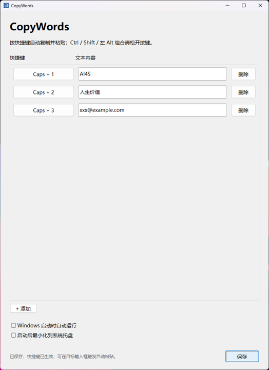
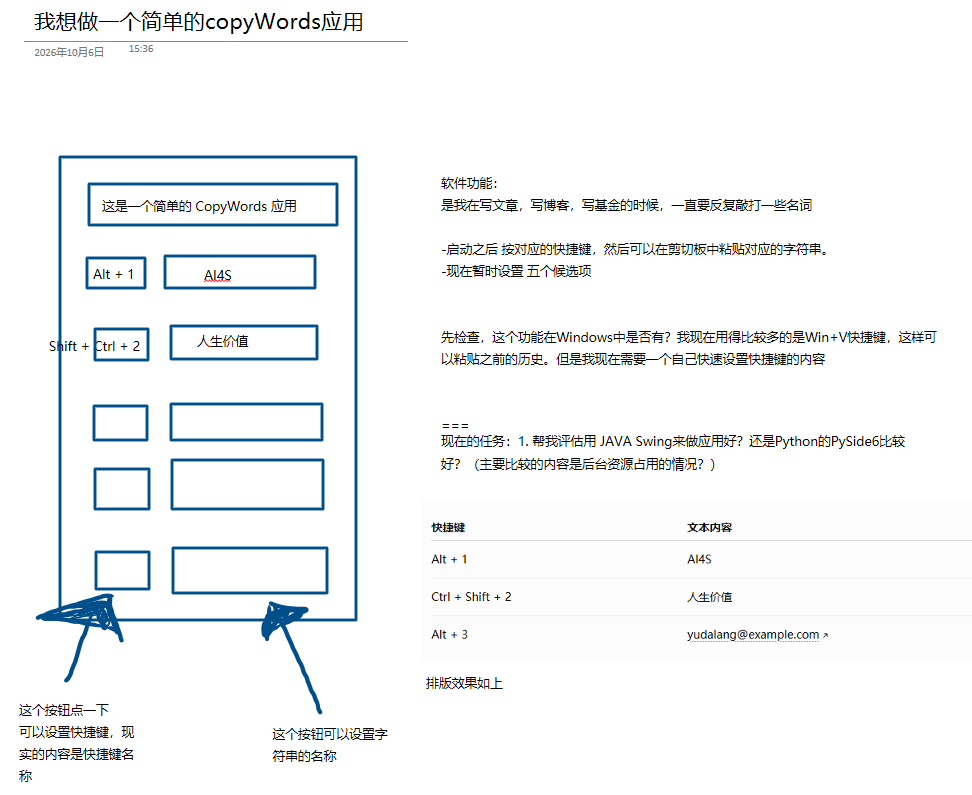
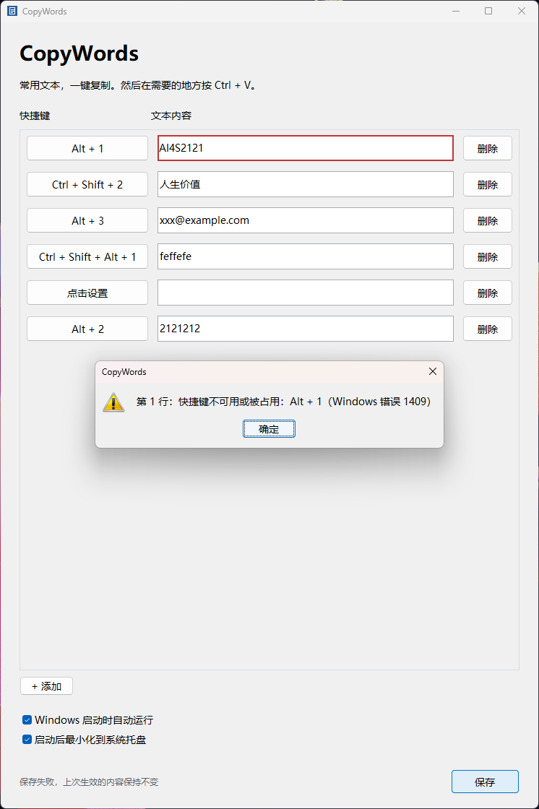
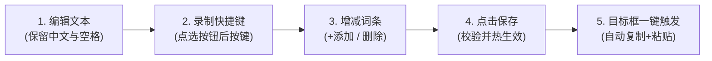

# CopyWords

<p align="center">
  <strong>专为 Windows 打造的常用文本一键自动粘贴工具</strong><br>
  <em>摆脱重复输入的繁琐，告别二次按键，按快捷键瞬间直达光标处。</em>
</p>

<p align="center">
  
  
  
  
  
</p>

---

<p align="center">
  
</p>

<p align="center">
  <em>图 1：CopyWords 现代极简主界面 —— 列表管理、自定义快捷键、开机自启与托盘驻留一目了然</em>
</p>

---

## 目录

- [为什么需要 CopyWords？](#为什么需要-copywords)
- [核心特性一览](#核心特性一览)
- [快速上手指南](#快速上手指南)
- [深入快捷键机制与排错](#深入快捷键机制与排错)
- [托盘管理与系统自启](#托盘管理与系统自启)
- [数据存储与安全保障](#数据存储与安全保障)
- [项目构建与测试](#项目构建与测试)
- [技术栈与开源协议](#技术栈与开源协议)

---

## 为什么需要 CopyWords？

在日常写文章、写论文、写博客、写项目基金，或者在 IDE 与聊天软件中输入时，总有一批**高频专有名词、特定邮箱、统一签名或常用代码短句**需要反复敲打：

> *“每次都要完整打一遍 `xxx@example.com` 或者长篇专业词汇太累；Windows 自带的 `Win + V` 剪贴板历史虽然能看记录，但它是被动的历史堆栈，顺序不停变动，每次还得肉眼翻找、点击或上下选择，打断思考心流。”*

为了解决这一痛点，作者最初用一张手绘原型纸勾勒出了 **CopyWords** 的雏形：

<p align="center">
  
</p>

<p align="center">
  <em>图 2：最初的需求构想手绘原型草图 —— 明确了快捷键直接绑定常用固定文本的核心思路</em>
</p>

### 传统输入 vs Win+V 历史 vs CopyWords

| 对比维度 | 手动敲打 | Windows 自带 `Win + V` | **CopyWords** |
| :--- | :--- | :--- | :--- |
| **输入耗时** | 慢，长词容易拼错 | 中等（呼出历史面板再寻找选择） | **极快（快捷键直达）** |
| **操作步骤** | 全键敲打 | 按 `Win+V` $\rightarrow$ 视线寻找 $\rightarrow$ 点击选定 | **按专属快捷键即自动输入** |
| **快捷键记忆** | 无 | 固定单一快捷键唤出大列表 | **支持肌肉记忆（如 `Caps + 1`、`Caps + 2`）** |
| **后台占用** | 无 | 系统剪贴板服务（可能漏记或失效） | **极低系统资源占用，静默驻留托盘** |
| **粘贴动作** | 手动 | 手动选择项后系统注入 | **智能模拟粘贴（Auto-Paste），无需再按 Ctrl+V** |

---

## 核心特性一览

### 1. ⚡ 真正的自动粘贴（Auto-Paste）
以往的快捷工具往往只帮你“复制到剪贴板”，你仍需额外按一次 `Ctrl + V`。CopyWords 采用**先进先出事件安全队列**与**键盘松键状态感知**，在按下快捷键后，自动将目标文本送入剪贴板并模拟粘贴到当前聚焦的光标处，一气呵成！

### 2. ⌨️ 独创 Caps 组合键无感设计
- 默认采用 `Caps + 数字（1~9, 0）`：无需弯曲手指扭曲手势，利用键盘最顺手的 CapsLock 键作为修饰键。
- **无冲突逻辑**：按住 Caps 再按数字即刻触发粘贴；松开数字后文本插入，此时 Caps 仍可继续按住。
- **不丢失原生功能**：独立轻点 Caps 键仍可正常切换英文大写锁定，组合使用绝不会意外打乱大小写状态。

### 3. 🛡️ 智能按键状态感知与修饰键保护
- 为防止模拟按键与用户物理按键发生修饰键粘滞（Modifier Clashing），程序会等待触发主键及 Ctrl / Shift / Alt 修饰键自然松开后再发送粘贴。
- **针对 Alt 键严格限制为左 Alt**：Windows 的 `RegisterHotKey` 原生机制在右 Alt 上极易与部分第三方输入法或全局监听产生冲突，CopyWords 严格识别并过滤，保证输入稳定性。

### 4. 🎯 直观的冲突检测与安全回滚
遇到热键被系统或其他软件占用（例如 Windows 错误代码 1409）时，绝不静默吞掉异常，也不会破坏当前可用配置：

<p align="center">
  
</p>

<p align="center">
  <em>图 3：快捷键被占用时的界面反馈 —— 出错行红色高亮定位，弹窗明确指出错误原因，保持上次配置有效不变</em>
</p>

- **行内精准红框**：一眼看出哪一行快捷键冲突。
- **状态栏与弹窗双重警示**：详细给出系统错误码，指导用户更换按键。
- **配置原子保护**：保存失败时自动回滚，确保现有生效条目不受损害。

### 5. 🖥️ 无缝托盘驻留与多显示器自适应
- 主界面关闭即最小化到系统托盘，内存与 CPU 占用极低。
- 托盘右键菜单经过专门的字体抗锯齿与渲染优化，彻底根除 Java 在高版本 Windows 下可能出现的 AWT 中文方块乱码。
- 自动记忆窗口尺寸、坐标与最大化状态；更换屏幕或分辨率时自动校正回可用工作区内。

### 6. 🔕 纯净无黑框（No Console Window）
- 构建附带 `CopyWords.lnk` 快捷方式，底层直接绑定 `javaw.exe`。
- 双击即开，无黑色的 cmd 控制台窗口跳闪。

---

## 快速上手指南

### 启动程序
双击项目根目录下的 **`CopyWords.lnk`（快捷方式）** 即可启动。当前已构建完成的程序位于 `dist/CopyWords.jar`，直接运行即可。

> [!NOTE]
> 首次启动若遇到被其他程序占用的快捷键，会有友好弹窗提示；其余未冲突的条目正常可用。

### 五步日常使用流程



1. **输入文本**：在右侧文本框输入常用词语、短句、邮箱或代码。文本为单行，中文及首尾空格均会原样保留。
2. **录制快捷键**：点击左侧快捷键按钮，直接按下你想要的组合键（如 `Caps + 1`，或按住 `Ctrl`/`Shift`/`左 Alt` + 字母/数字/F1–F11），然后点击“确定”。
3. **添加与删除**：点击底部 **“+ 添加”** 增加新行（新增条目将优先分配尚未占用的 `Caps + 1~9, 0`）；点击每行右侧的 **“删除”** 即可移除。
4. **保存生效**：点击右下角 **“保存”**。所有快捷键即刻注册生效。若某行冲突，该行会显示红框提示修改。
5. **任意位置一键粘贴**：在微信、浏览器输入框、Word、Notepad 或 IDE 等目标应用的光标处，按下对应快捷键，松开主键即刻自动键入！

### 默认预设配置

软件初次运行默认预设了前三行常用场景：

| 快捷键 | 预设文本内容 | 适用典型场景 |
| :--- | :--- | :--- |
| `Caps + 1` | `AI4S` | 论文 / 专业领域特定缩写 |
| `Caps + 2` | `人生价值` | 文章 / 常用核心论述词汇 |
| `Caps + 3` | `xxx@example.com` | 常用联系人邮箱 / 账号 |

---

## 深入快捷键机制与排错

### 1. 快捷键录制规则
- **保留按键**：`Ctrl + V` 保留作为粘贴行为，不能作为条目快捷键。
- **Alt 限制为左 Alt**：自定义 Alt 组合（包括 Caps + Alt）仅接受左 Alt，显示为“左 Alt + …”；右 Alt 录制时会提示改用左 Alt 或 Caps。
- **修饰键支持**：Ctrl 和 Shift 仍完整支持键盘左右两侧。
- **空条目保护**：空文本或未设置快捷键的条目不会被注册。

### 2. 自动粘贴保护机制
- **松键释放检测**：按住 `Caps + 1` 触发时，程序会在检测到数字键 `1` 松开后立刻发送粘贴事件；Caps 键允许保持按住状态，方便连续操作。
- **超时丢弃**：每次粘贴请求从触发时起最多等待 1 秒，若用户长时间不松开按键则自动超时取消并给予提示。
- **焦点与窗口保护**：如果在等待发送过程中用户切换了前台活动窗口、或进入了快捷键录制状态，待发送的粘贴请求将安全取消，防止误粘贴到未知窗口。
- **剪贴板保护**：如果在触发后被外部其他程序抢占修改了剪贴板，CopyWords 会优先保留外部内容并取消当次自动粘贴。
- **UAC 管理员权限边界**：Windows 安全机制禁止普通权限程序向更高权限（管理员运行）的应用窗口注入模拟键盘事件。若目标应用是以管理员身份运行的，自动粘贴可能无法写入，但此时文本已复制到系统剪贴板，手动按 `Ctrl + V` 即可粘贴。

---

## 托盘管理与系统自启

<p align="center">
  
  
  
</p>

- **关闭即托盘**：点击窗口右上角关闭按钮，程序默认隐藏至系统托盘继续服务。
- **右键菜单**：右键点击托盘图标可弹出菜单（包含“打开设置”与“退出”）。菜单支持按 `Escape` 键或点击其他区域自动关闭。
- **重复启动保护**：当程序已在托盘运行时，再次双击运行将自动弹出提示并直接唤醒已存在的窗口。
- **安全退出确认**：若有未保存的修改，退出前会弹出确认对话框供您选择“保存退出”、“丢弃修改退出”或“取消”。
- **开机自启选项**：
  - 勾选“Windows 启动时自动运行”：写入当前用户的 Windows Run 注册表，登录系统后自动启动，无需管理员提权。首次点击保存后正式生效。
  - 勾选“启动后最小化到系统托盘”：开机自启后静默缩入托盘，不打扰屏幕视觉。

---

## 数据存储与安全保障

CopyWords 秉持数据自主与完全本地化原则，所有配置文件均存放于 Windows 标准应用数据路径：

```text
%APPDATA%\CopyWords\
├── config.xml          # 核心配置：保存所有文本条目与快捷键绑定
├── window-state.xml    # 界面状态：独立保存窗口坐标、宽高与最大化状态
└── logs/               # 运行诊断日志与异常排查记录
```

- **配置独立性**：文本配置与窗口状态完全解耦，窗口拖动缩放无需频繁触发文本写盘。
- **原子替换（Atomic Replacement）**：配置保存采用“先写临时文件再原子覆盖”的方式，断电或异常绝不损坏原有配置。
- **剪贴板重试**：遇到剪贴板被其他应用瞬间占用的情况，内置 3 次短暂重试机制。

---

## 项目构建与测试

### 开发环境要求
- **操作系统**：Windows 10 / 11
- **Java 环境**：JDK 25
- **构建工具**：Apache Maven

### 一键构建与打包
在项目根目录下通过 PowerShell 运行自带构建脚本：

```powershell
powershell -NoProfile -ExecutionPolicy Bypass -File .\scripts\build.ps1
```

该脚本会自动执行：
1. 下载必要依赖至 `temp/m2`（不污染全局配置）。
2. 执行全部自动化测试。
3. 打包生成包含 JNA 本机 DLL 的独立运行 JAR：`dist/CopyWords.jar`。
4. 基于当前系统的 `javaw.exe` 自动在根目录下创建/更新 `CopyWords.lnk` 快捷方式。

### 运行程序
除了双击 `CopyWords.lnk` 外，也可以通过脚本启动：

```powershell
powershell -NoProfile -ExecutionPolicy Bypass -File .\scripts\run.ps1
```

### 自动化测试与验证体系
本项目拥有严苛的自动化测试套件（含单元测试与 Windows 原生模拟测试）：

```powershell
# 运行常规测试（31项）
mvn -B '-Dmaven.repo.local=temp/m2' test

# 运行完整测试（含12项原生键鼠操作与剪贴板模拟测试，共43项）
mvn -B '-Dmaven.repo.local=temp/m2' '-Dcopywords.windowsSmoke=true' test
```

> [!WARNING]
> 运行原生测试（`windowsSmoke=true`）期间，请保持屏幕解锁且暂时不要操作键盘鼠标。

针对高分屏及图形界面，可运行专项 UI Smoke 校验脚本：

```powershell
# 100% 缩放 UI 校验
java --enable-native-access=ALL-UNNAMED -cp dist/CopyWords.jar scripts/UiSmoke.java
java --enable-native-access=ALL-UNNAMED -cp dist/CopyWords.jar scripts/WindowStateExitCheck.java

# 150% 高分屏缩放 UI 校验
java --enable-native-access=ALL-UNNAMED '-Dsun.java2d.uiScale=1.5' -cp dist/CopyWords.jar scripts/UiSmoke.java 150percent
java --enable-native-access=ALL-UNNAMED -cp dist/CopyWords.jar scripts/WindowStateExitCheck.java 150percent
```

相关验收报告详见：
- `logs/auto-paste-verification.md`（自动粘贴机制验收）
- `logs/window-state-verification.md`（窗口状态与托盘功能验收）
- `logs/caps-verification.md`（Caps 组合键行为验收）

---

## 技术栈与开源协议

- **开发语言**：Java 25
- **GUI 框架**：Java Swing
- **系统底层交互**：[JNA / JNA Platform 5.19.1](https://github.com/java-native-access/jna)（Apache-2.0 License）
  - 低级键盘钩子（Low-Level Keyboard Hook）用于 Caps 组合键精准截获与修饰键状态判定
  - Windows `RegisterHotKey` API 用于标准全局组合键注册与冲突探测
  - Windows Run Registry Key 用于开机自启托管
- **开源协议**：本项目基于 **GNU General Public License v3.0** 许可证开源，详见 [LICENSE](LICENSE)。
- **开发与历史备忘**：重构前的原始说明及开发备忘请查阅 [dev_log.md](dev_log.md)。

