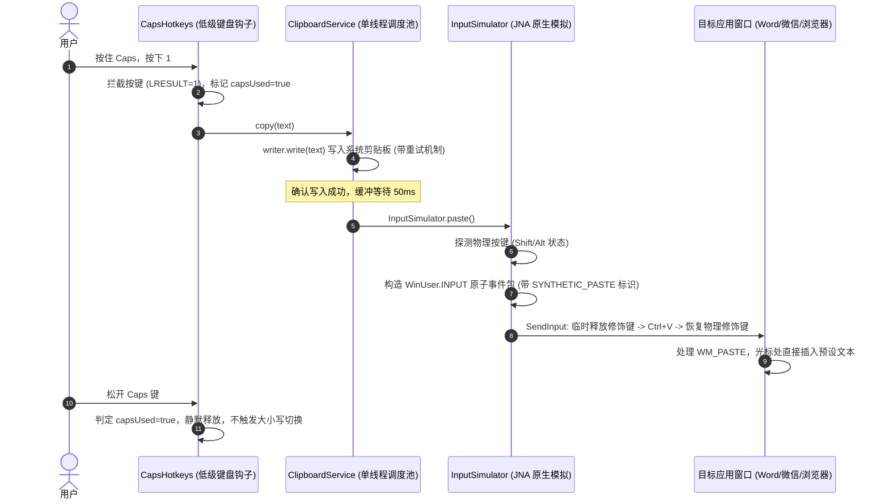

# 快捷键直接粘贴（Auto-Paste）方案调研与落地设计

本文档记录了关于 **copyWords** 实现“快捷键直接粘贴（如 `Caps + 1` 直接粘贴到光标处）”的完整问题背景、对参考项目 **CapsWriter-Offline** 的源码调研剖析、思考与推导过程，以及最终在本项目中的落地实施方案。

---

## 一、 问题背景与核心诉求

### 1.1 现状与痛点
在 `copyWords` 当前版本中，预设文本的使用流程为两步：
1. 用户在外部软件（如 Word、微信、浏览器）中按下快捷键（如 `Caps + 1`）；
2. 文本被写入 Windows 系统剪贴板；
3. 用户**必须手动再次按下 `Ctrl + V`** 完成粘贴。

### 1.2 目标
实现**一步到位**的直觉体验：
用户按下 `Caps + 1` 后，文本立即自动插入到当前活动窗口的光标聚焦处，无需手动再按 `Ctrl + V`。同时确保：
- 单独单击 `Caps` 键依然可以正常切换大小写；
- 粘贴后的文本保留在系统剪贴板中供后续使用；
- 保持界面极简，不增加冗余配置项。

---

## 二、 参考项目调研：CapsWriter-Offline 源码深度剖析

针对该问题，我们深入调研了本地语音输入项目：
`C:\Users\yudal\Documents\software\CapsWriter-Offline\CapsWriter-Offline`

CapsWriter 是一个长按 CapsLock 录音并输出文字的工具，它在解决“将文字直接送到当前窗口光标处”方面有成熟且经过实际检验的架构设计：

### 2.1 模拟粘贴与剪贴板控制 (`core/client/output/text_output.py`)
CapsWriter 在输出识别结果时支持两种模式：**模拟打字**（`keyboard.write`）与**模拟粘贴**（`_paste_text`）。其模拟粘贴的核心实现如下：
```python
async def _paste_text(self, text: str) -> None:
    # 1. 暂存当前剪贴板（供后续可选恢复）
    try:
        temp = pyclip.paste().decode('utf-8')
    except Exception:
        temp = ''
    
    # 2. 将要输出的目标文本复制到剪贴板
    pyclip.copy(text)
    
    # 3. 模拟发送 Ctrl+V (macOS 则发送 Cmd+V)
    controller = pynput_keyboard.Controller()
    if platform.system() == 'Darwin':
        with controller.pressed(pynput_keyboard.Key.cmd):
            controller.tap('v')
    else:
        with controller.pressed(pynput_keyboard.Key.ctrl):
            controller.tap('v')
            
    # 4. 可选还原旧剪贴板 (延迟 100ms 避免与目标应用的 WM_PASTE 竞争)
    if Config.restore_clip:
        await asyncio.sleep(0.1)
        pyclip.copy(temp)
```

### 2.2 目标窗口兼容性探测 (`core/client/output/result_processor.py`)
部分富文本或特权应用（如微信 `WeiXin.exe`、Telegram）对模拟逐字打字支持不佳，容易丢失拼音或受输入法拦截。CapsWriter 通过 Win32 API 获取当前前台窗口进程名：
- 当检测到进程命中 `paste_apps` 列表时，**强制降级切换为“剪贴板 + 模拟 Ctrl+V”模式**，保证 100% 粘贴成功率。

### 2.3 CapsLock 键拦截与防冲突机制 (`core/client/shortcut/shortcut_manager.py` & `task.py`)
CapsWriter 使用 CapsLock 作为主触发键，面临与大小写切换的冲突：
- **低级键盘钩子拦截（Suppress 模式）**：
  在 Windows 低级钩子回调中直接吞掉 CapsLock 按键消息（不传给系统和前台应用），使长按 CapsLock 时系统不会反复切换大小写状态；
- **短按补发（Threshold 判断）**：
  如果用户按住 CapsLock 的时间很短（`< 0.3s`），则判定用户意图为“切换大小写”，由后台模拟器（`emulator.py`）异步补发一次 CapsLock 按键；
- **防自捕获标志（Self-Capture Prevention）**：
  在补发或模拟按键时维护一个集合（`_emulating_keys` / `_restoring_keys`），底层钩子捕获到自身发出的按键事件时直接放行，避免陷入“模拟发送 $\rightarrow$ 钩子又捕获 $\rightarrow$ 死循环”的递归陷阱。

---

## 三、 思考过程与技术难点推演

借鉴 CapsWriter 的思路，并对照 `copyWords` 项目自身的技术栈（Java 25 + JNA 5.19.1），我们推演并解决了以下六个关键技术点与方案权衡：

### 3.1 难点一：物理修饰键冲突与状态精准恢复（Modifier State Collision & Restoration）
- **现象推演**：
  1. **低级钩子场景（`Caps + 数字`）**：`CapsHotkeys` 通过 `WH_KEYBOARD_LL` 已经拦截了 Caps 键本身，系统前台不会收到 Caps 物理按下消息；但用户手指可能同时搭在 `Shift` 或其他键上；
  2. **系统全局热键场景（`Alt + 数字` 或 `Ctrl + Shift + 数字`）**：`GlobalHotkeys` 基于 Win32 `RegisterHotKey` / `WM_HOTKEY`，触发时用户的 `Alt` 或 `Shift` 正处于物理按压状态！若直接模拟 `Ctrl + V`，系统前台应用收到的按键会与物理按键叠加，变成 `Ctrl + Alt + V`（在许多软件中无反应或呼出特定菜单）或 `Ctrl + Shift + V`（无格式粘贴或特殊功能）；
  3. **单向释放后遗症**：若盲目向系统发送 `Shift/Alt Up` 且事后不恢复，会导致 Windows 按键状态机与用户物理按压脱节：用户手指仍按着物理键，系统却认为已松开，当用户真正松手时操作系统无法正常捕捉抬起事件，极易导致 Alt 键“粘滞”（如误激活前台窗口菜单栏）。
- **解决方案（状态探测 + 临时抑制 + 精准恢复）**：
  1. 通过 `User32.INSTANCE.GetAsyncKeyState` 动态探测物理按键状态；
  2. 仅在检测到 `Shift` 或 `Alt` 确实处于物理按下时，在发送 `Ctrl + V` 前将它们作为事件包的一部分临时发送 `KEYEVENTF_KEYUP`；
  3. 发送纯净的 `Ctrl Down -> V Down -> V Up -> Ctrl Up`；
  4. **关键恢复**：在事件包末尾，针对此前处于物理按下的修饰键重新补发 `KeyDown`，恢复操作系统的真实物理状态。整个过程打包在单次 `SendInput` 中作为原子事务执行。

### 3.2 难点二：剪贴板写入与按键发送的时序竞争（Race Condition）
- **现象推演**：
  在 Windows 下，写入剪贴板（`Toolkit.getDefaultToolkit().getSystemClipboard().setContents(...)`）后，操作系统需向系统各窗口异步广播剪贴板更新消息。
  如果程序在写入剪贴板后立即（0ms）发送 `Ctrl + V`，目标应用收到 `WM_PASTE` 消息去读取剪贴板时，可能剪贴板尚未就绪或仍被系统剪贴板链监听者占用，导致贴出的内容是**上一次复制的历史内容**。
- **解决方案（缓冲延迟优化）**：
  原预案建议 25ms 延迟，但实测中在系统高负载或开启剪贴板监视工具（如 Windows 自带剪贴板历史 `Win + V`、Ditto、Snipaste 等监听 `WM_CLIPBOARDUPDATE`）时，25ms 依然偏紧。
  参考 CapsWriter 的 100ms 实践，我们在 `ClipboardService` 单线程后台调度池中采用 **50 毫秒缓冲延迟**。50ms 在人机交互中依然处于完全无感知的即时响应范畴（人眼感知的即时延迟阈值为 50~100ms），但能显著增强剪贴板就绪的稳定性与重试容错空间。

### 3.3 难点三：防自捕获标志（Self-Capture Prevention）与低级钩子协同
- **深入分析**：
  `copyWords` 的 [`CapsHotkeys.java`](file:///c:/Users/yudal/Documents/GitHub/copyWords/src/main/java/cn/copywords/CapsHotkeys.java) 实现了基于 Win32 `WH_KEYBOARD_LL` 的低级钩子：
  1. 钩子内部通过 `SYNTHETIC_CAPS = 0x43574F52L` ("CWOR") 过滤由自身模拟发出的 CapsLock 切换按键；
  2. 如果 `InputSimulator` 模拟发出的 `Ctrl`、`V`、`Shift`、`Alt` 按键未做特殊标记，这些模拟按键同样会被 `CapsHotkeys` 的 `onKey()` 捕获并更新内部物理状态集合 `downKeys`，不仅可能污染快捷键录制逻辑，甚至可能引发意外判定。
- **解决方案**：
  在 `InputSimulator` 中定义专用的防自捕获签名常量 `SYNTHETIC_PASTE = 0x43574F53L` ("CWOS")，写入所有模拟按键事件的 `dwExtraInfo`；同时在 `CapsHotkeys.onKey()` 开头同步检查该标记，检测到自身发出的粘贴按键时直接放行，避免模拟按键污染内部状态。

### 3.4 难点四：剪贴板保留策略的取舍（方案 A vs 方案 B）
- **方案对比**：
  - **方案 B（CapsWriter 方案）**：粘贴后延迟 100ms 将剪贴板还原为用户之前的旧内容；
  - **方案 A（常用短语工具方案）**：粘贴后，文本依然保留在剪贴板中。
- **取舍结论**：
  选择**方案 A**。在常用词工具场景下，用户通常期望当前文本保留在剪贴板中，以便在其他输入框直接再次 `Ctrl + V`。频繁恢复剪贴板反而会引发多次剪贴板锁争用（`ClipboardBusyException`）。

### 3.5 难点五：UI 交互与直觉设计
- **讨论**：是否需要在主窗口底部增加 `[√] 快捷键触发后自动粘贴` 的复选框选项？
- **结论**：**不需要**。用户对于常用短语工具的直觉预期就是“按快捷键就贴出文字”。保持软件的极简纯粹，避免给用户增加多余的配置和心智负担。

### 3.6 决策探讨：为什么不采用“逐字模拟输入”（Unicode Typing / KEYEVENTF_UNICODE）？
针对“是否应像部分打字软件一样，采用逐字模拟击键（Unicode 字符流）而不是剪贴板粘贴”的疑问，进行了深入的技术评估并坚决予以否决，原因如下：
1. **中文输入法（IME）冲突拦截**：
   在 Windows 系统下，当光标所在窗口处于中文输入状态（如微软拼音、搜狗输入法）时，通过 `SendInput(KEYEVENTF_UNICODE)` 发送的字符流会被活动输入法拦截并误作为拼音拼写串塞入候选框，导致中文乱码、断字或产生拼音飞溅；
2. **长文本性能与吞吐量差异（$O(1)$ vs $O(N)$）**：
   逐字模拟按键是 $O(N)$ 的时序流，对于包含数百字符的模板短语或段落，逐字输入会有肉眼可见的“敲字等待时间”；而剪贴板粘贴是瞬时 $O(1)$ 的内存/消息操作；
3. **换行与格式兼容性**：
   不同宿主程序（经典 Win32 控件、WPF、Electron、网页富文本）对模拟 Unicode 按键中的 `\r\n` 解析极不统一，容易出现丢失换行或产生双重换行的排版错乱；
4. **参考项目 CapsWriter 的前车之鉴**：
   CapsWriter 虽支持模拟打字模式，但其实际运行中不得不维护了一个庞大的 `paste_apps` 强制降级白名单（微信、Telegram 等多达数十个应用均被强制切回剪贴板粘贴）。`copyWords` 作为极简文本工具，若引入逐字输入将不得不引入复杂的进程探测与黑白名单兼容层，得不偿失。
因此，“写入系统剪贴板 + 纯净模拟 `Ctrl + V`”是兼具 100% 格式保真度、输入法免疫与最高性能的唯一最优解。

---

## 四、 最终技术落地实施方案

### 4.1 核心流程时序图



### 4.2 具体改动设计

#### 1. 新增 Win32 模拟按键工具类：`src/main/java/cn/copywords/InputSimulator.java`
基于现有的 JNA 5.19.1 原生调用 `User32.INSTANCE.SendInput`，实现修饰键感知与恢复、带防自捕获标志：
```java
package cn.copywords;

import com.sun.jna.platform.win32.*;
import com.sun.jna.platform.win32.WinDef.*;
import java.util.ArrayList;

public final class InputSimulator {
    /** 防自捕获标志，低级键盘钩子识别该 extraInfo 时直接放行，避免污染内部按键状态 */
    public static final long SYNTHETIC_PASTE = 0x43574F53L; // "CWOS"

    private static final int VK_SHIFT = 0x10;
    private static final int VK_CONTROL = 0x11;
    private static final int VK_MENU = 0x12; // Alt
    private static final int VK_V = 0x56;

    public static void paste() {
        // 1. 动态检测物理修饰键状态（兼容 RegisterHotKey 如 Alt+1 或物理残留按键）
        boolean shiftDown = isKeyDown(VK_SHIFT);
        boolean altDown = isKeyDown(VK_MENU);

        var list = new ArrayList<WinUser.INPUT>();

        // 2. 若物理键处于按下状态，先临时注入 KEYUP 抬起，避免与 Ctrl+V 叠加为 Ctrl+Alt+V 或 Ctrl+Shift+V
        if (shiftDown) list.add(keyInput(VK_SHIFT, true));
        if (altDown) list.add(keyInput(VK_MENU, true));

        // 3. 模拟纯净的 Ctrl + V (Ctrl Down -> V Down -> V Up -> Ctrl Up)
        list.add(keyInput(VK_CONTROL, false));
        list.add(keyInput(VK_V, false));
        list.add(keyInput(VK_V, true));
        list.add(keyInput(VK_CONTROL, true));

        // 4. 精准恢复：对原本物理按下的修饰键补发 KEYDOWN，恢复 OS 物理真实按键状态，防止 Alt 粘滞
        if (altDown) list.add(keyInput(VK_MENU, false));
        if (shiftDown) list.add(keyInput(VK_SHIFT, false));

        var inputs = list.toArray(new WinUser.INPUT[0]);
        User32.INSTANCE.SendInput(new DWORD(inputs.length), inputs, inputs[0].size());
    }

    private static boolean isKeyDown(int vk) {
        return (User32.INSTANCE.GetAsyncKeyState(vk) & 0x8000) != 0;
    }

    private static WinUser.INPUT keyInput(int vk, boolean keyUp) {
        var input = new WinUser.INPUT();
        input.type = new DWORD(WinUser.INPUT.INPUT_KEYBOARD);
        input.input.setType("ki");
        input.input.ki = new WinUser.KEYBDINPUT();
        input.input.ki.wVk = new WORD(vk);
        input.input.ki.wScan = new WORD(0);
        input.input.ki.dwFlags = new DWORD(keyUp ? WinUser.KEYBDINPUT.KEYEVENTF_KEYUP : 0);
        input.input.ki.time = new DWORD(0);
        input.input.ki.dwExtraInfo = new BaseTSD.ULONG_PTR(SYNTHETIC_PASTE);
        return input;
    }
}
```

#### 2. 修改剪贴板服务：[`ClipboardService.java`](file:///c:/Users/yudal/Documents/GitHub/copyWords/src/main/java/cn/copywords/ClipboardService.java)
在剪贴板写入成功后，延迟 50ms 触发自动粘贴：
```diff
     private void attempt(String text, int retries, long request) {
         if (request != generation) return;
         try {
             writer.write(text);
-            status.accept("已复制到剪贴板。松开快捷键后，在 Word 或网页按 Ctrl + V 粘贴。");
+            worker.schedule(() -> {
+                if (request == generation) {
+                    InputSimulator.paste();
+                    status.accept("已自动粘贴");
+                }
+            }, 50, TimeUnit.MILLISECONDS);
         } catch (IllegalStateException exception) {
             if (retries < 3) worker.schedule(() -> attempt(text, retries + 1, request), 100, TimeUnit.MILLISECONDS);
             else status.accept("复制失败：剪贴板正在被其他程序占用，请重新按快捷键");
         } catch (RuntimeException exception) { status.accept("复制失败：" + exception.getMessage()); }
     }
```

#### 3. 增强低级键盘钩子防自捕获过滤：[`CapsHotkeys.java`](file:///c:/Users/yudal/Documents/GitHub/copyWords/src/main/java/cn/copywords/CapsHotkeys.java)
在 `onKey` 方法中放行 `SYNTHETIC_PASTE`，防止模拟的按键被错误计入 `downKeys` 跟踪或影响录制：
```diff
     private LRESULT onKey(int code, WPARAM event, WinUser.KBDLLHOOKSTRUCT key) {
-        if (code < 0 || key.dwExtraInfo.longValue() == SYNTHETIC_CAPS) return next(code, event, key);
+        if (code < 0 || key.dwExtraInfo.longValue() == SYNTHETIC_CAPS || key.dwExtraInfo.longValue() == InputSimulator.SYNTHETIC_PASTE) return next(code, event, key);
         try {
```

#### 4. 修改界面提示：[`CopyWords.java`](file:///c:/Users/yudal/Documents/GitHub/copyWords/src/main/java/cn/copywords/CopyWords.java)
将主界面副标题提示文字简化：
```diff
-        heading.add(new JLabel("按住 Caps，再按数字复制；松开后按 Ctrl + V 粘贴。"), BorderLayout.SOUTH);
+        heading.add(new JLabel("按住 Caps，再按数字即可直接粘贴。"), BorderLayout.SOUTH);
```

#### 5. 修改说明文档：[`README.md`](file:///c:/Users/yudal/Documents/GitHub/copyWords/README.md)
更新快捷键使用说明，明确快捷键现已具备直接粘贴到当前应用的能力。

---

## 五、 验证与测试方案

### 5.1 自动化测试计划
1. **现有测试改造（`WindowsSmokeTest.java`）**：
   在现有的 `capsCopiesAndPastesWithoutTypingDigitsOrChangingCase` 中：
   - **原有逻辑**：按 `Caps + 1` 后断言编辑器内文本为空 `assertEquals("", editor.getText())`，然后需手动执行 `press(0xA2, 'V')` 验证能否手动粘贴；
   - **升级后逻辑**：快捷键触发后由于具备自动粘贴能力，等待约 150ms 缓冲后，**直接断言 `assertEquals("AI4S", editor.getText())`**，验证自动粘贴已经生效；省去手动补发 `Ctrl+V` 的过渡验证。
2. **修饰键恢复专项集成测试**：
   - 编写 `testModifierStateRestoredAfterPaste()`：模拟在物理按压 `VK_MENU` (Alt) 的状态下触发粘贴，断言粘贴完成后 `User32.INSTANCE.GetAsyncKeyState(VK_MENU)` 的物理按下状态依然维持，没有发生按键状态被吞噬的异常；
   - 验证 `GlobalHotkeys` 注册的普通热键（如基于 `RegisterHotKey` 的组合键）触发时同样能正确完成自动粘贴。
3. **回归构建与冒烟测试运行**：
   ```powershell
   cmd /c mvn -B "-Dmaven.repo.local=temp/m2" test
   cmd /c mvn -B "-Dmaven.repo.local=temp/m2" "-Dcopywords.windowsSmoke=true" test
   ```

### 5.2 手工多场景验证清单
1. **多类型应用兼容性验证**：在记事本（Win32 Edit）、微信/企业微信（富文本）、Word、浏览器地址栏、VS Code/终端等各类型前台窗口聚焦，按下 `Caps + 1`，确认文本均能直接进入光标处；
2. **中文输入法（IME）激活状态验证**：在前台窗口处于微软拼音或搜狗输入法的中文输入状态下按下快捷键，确认文本直接粘贴插入，不会被输入法截获为拼音字母或触发候选框弹出；
3. **修饰键无粘滞验证**：测试通过非 Caps 组合键（如 `Alt + 1`）触发自动粘贴，操作完成后快速敲击其他按键，确认 Windows 系统的 Alt 键未发生粘滞（即不会误激活窗口顶部的“文件/编辑”菜单栏）；
4. **剪贴板监视工具共存验证**：开启 Windows 自带剪贴板历史记录（`Win + V`）或第三方剪贴板工具（Ditto、Snipaste），连续触发多次不同文本快捷键，确认 50ms 延迟下无剪贴板争用报错，且剪贴板历史中能正常记录新内容；
5. **大小写切换完整保留**：单独轻击 `Caps` 键，确认键盘 CapsLock 指示灯与系统输入法大小写依然可以正常切换。
