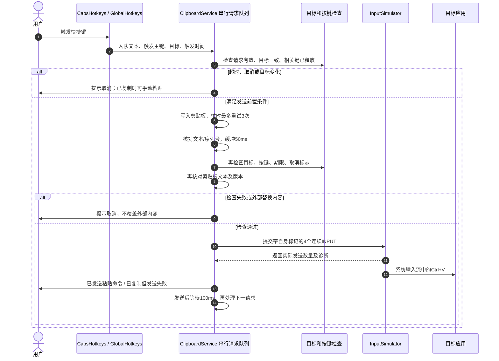

# 快捷键直接粘贴（Auto-Paste）方案调研与落地设计

本文档记录 copyWords 实现“快捷键自动粘贴到当前光标处”的背景、参考源码和实施方案。

**修订日期：2026-10-07。当前状态：功能已实现，42项自动测试及100%/150% Robot 界面测试通过；输入法和外部监听的已知限制见 `logs/auto-paste-verification.md`。** 文中的“修改说明”解释审核后调整的原因；代码片段用于说明设计，支持范围以实际验收记录为准。

---

## 一、问题背景与核心诉求

### 1.1 现状与痛点

当前使用预设文本需要两个动作：

1. 在外部软件中按下快捷键，例如 `Caps + 1`，将文本复制到剪贴板。
2. 手动按 `Ctrl + V`，粘贴到当前输入位置。

### 1.2 目标与行为约定

用户触发快捷键后，由程序完成复制和发送粘贴命令，无需手动按 `Ctrl + V`。同时满足：

- 单独按 Caps 仍可切换大小写；使用 Caps 组合键不改变大小写状态。
- 正常发送粘贴后保留本次文本在剪贴板中，供用户再次手动粘贴。
- 不新增自动粘贴开关，不引入逐字输入模式或应用进程白名单。
- 等待触发主键及相关修饰键自然释放，再发送粘贴。默认 Caps 组合只需松开数字或字母，Caps 可以继续按住。
- 每次有效触发进入先进先出队列；在目标未变化、请求未超时的前提下，每个请求发送一次粘贴，不因后续请求到来而静默丢弃。
- 目标或剪贴板变化、等待超时、暂停、退出以及原生调用失败时，明确提示取消或失败；不继续向新的输入位置发送粘贴。

> **修改说明：**原方案将“立即插入”作为无条件保证，但按键可能仍未释放，目标可能切换，应用也可能拒绝粘贴。这里明确正常行为与取消条件，避免实现时用强制改键盘状态或误报成功来满足过强承诺。

### 1.3 兼容性边界

v1 使用纯文本剪贴板和 `Ctrl + V`，优先验收同权限下的记事本、Word、浏览器输入框及微信。目标控件是否接受粘贴、IME 组合状态如何处理、终端是否将 `Ctrl + V` 作为粘贴，均需按实际应用验证。

普通权限的 copyWords 不能保证向管理员权限窗口注入输入。发送失败时保留已写入的剪贴板文本供手动使用；不自动提权，不增加切换粘贴快捷键的配置。发送成功只能确认输入事件已提交，不能确认目标应用已经插入文本。

---

## 二、参考项目源码核对

参考本地项目：`C:\Users\yudal\Documents\software\CapsWriter-Offline\CapsWriter-Offline`。以下结论对应本次读取到的源码版本，不将其实现直接视为本项目的兼容性验证。

### 2.1 模拟粘贴与剪贴板控制

`core/client/output/text_output.py` 的 `_paste_text` 先复制文本，再立即模拟 `Ctrl + V`；如果开启 `restore_clip`，在发送粘贴后等待 100ms，再恢复旧剪贴板。简化流程如下：

```python
pyclip.copy(text)
controller = pynput_keyboard.Controller()
with controller.pressed(pynput_keyboard.Key.ctrl):
    controller.tap('v')

# 这段等待发生在粘贴之后，用于延后恢复旧剪贴板。
if Config.restore_clip:
    await asyncio.sleep(0.1)
    pyclip.copy(previous_text)
```

> **修改说明：**原文把这里的 100ms 当作“复制后等待再粘贴”的参考依据，时序读反了。copyWords 的粘贴前缓冲应自行验证，不能由这段恢复旧剪贴板的逻辑推导出来。

### 2.2 目标窗口兼容性处理

`core/client/output/result_processor.py` 按当前应用选择输出方式。此次核对的 `config_client.py` 默认 `paste=False`，`paste_apps` 为 `['WeiXin.exe', 'Telegram.exe']`；命中列表时采用剪贴板粘贴。

> **修改说明：**删除“数十个应用的庞大白名单”和“保证 100% 成功”的描述。指定源码的列表只有两项；选择粘贴方式也不能绕过权限限制或目标控件的处理规则。

### 2.3 CapsLock 拦截与防自捕获

参考项目采用 Caps 拦截、短按补发及模拟事件防自捕获。copyWords 已有自己的 Caps 按下、组合使用和单键补发逻辑，应保留现有规则，不引入参考项目用于录音的 0.3 秒长短按阈值。

自身模拟的粘贴按键需要标记并在 Caps 钩子中放行，防止污染按键跟踪和快捷键录制。`RegisterHotKey` 路径另行处理，见 3.3。

---

## 三、关键技术决策及修改原因

### 3.1 等待按键释放，避免强制释放与恢复

在后台检查左右 Ctrl、Shift、Alt、Win，以及触发主键和 V 键是否已释放。每隔 **10ms** 重新检查一次，单个请求从触发时起最多等待 **1000ms**；该期限包含排队、剪贴板重试与粘贴前缓冲。使用单调时钟计算期限。10ms 和 1000ms 是 v1 的初始设计值，后续按响应速度与取消率验收，不作为已经实测的结论。

- 普通修饰键按左右键分别读取当前状态，不将 `GetAsyncKeyState` 称为独立的物理键状态证明。
- Caps 钩子会吞掉触发主键事件，不能仅依靠系统异步状态判断其释放。`CapsHotkeys` 应发布线程安全的只读按键快照，供后台判断触发主键和 V 的状态；快照在真实或外部输入的按下、抬起事件处理后更新。
- 自身的 `SYNTHETIC_CAPS`、`SYNTHETIC_PASTE` 事件不更新该快照。钩子回调不等待、不读写剪贴板、不发送粘贴。
- 阻塞键仍按住时继续等待，目标变化、暂停或超时则取消。在发送前再检查一次键状态；不要求 Caps 释放。

> **修改说明：**原方案漏掉 Ctrl：无条件发送 Ctrl Up 会释放用户仍按住的 Ctrl。它也未保存左右 Shift/Alt 身份，不能兑现“精准恢复”。改为等待自然释放，可减少误激活菜单、改变后续组合键和快照过期后补发错误 KeyDown 的风险。检查与注入之间仍有很短的竞争窗口，不能宣称与物理键盘操作构成原子事务。

### 3.2 剪贴板缓冲、版本和内容检查

沿用剪贴板忙时每隔 **100ms** 重试、最多 **3 次重试**的上限。写入成功后使用 **50ms** 粘贴前缓冲，作为待验收的初始参数。

写入后记录剪贴板序列号并核对文本；发送前再次核对序列号和文本。Windows 实现用 `OpenClipboard` 保持读取期间的剪贴板锁，通过 `GetClipboardData(CF_UNICODETEXT)` 和 `GlobalLock` 读取实际原生文本，再记录序列号，最后关闭剪贴板；读取会先完成延迟呈现。文本与请求完全相同才接受快照，发送前再次确认序列号未变。保留中文及前后空白，不做 trim。

若读取忙，只在原请求期限内重试核对；若内容或版本已被外部修改、无法可靠确认，则取消自动粘贴，不重新覆盖外部内容。明确检测到外部修改时，也取消尚未发送的旧请求。AWT 可能延迟提供剪贴板格式，序列号应在读取确认后取得，不能仅凭一次写入后的取值认定内容已稳定。

> **修改说明：**50ms 不能证明所有剪贴板监听者已经处理完成，也不能防止其他程序在等待期间复制新内容。原文“25ms 实测偏紧”未附复现条件或数据，予以删除。序列号与文本核对用于减少贴错内容的风险，但最后核对与目标读取之间仍无法完全消除竞争。

> **实现说明：**原生读取期间持有剪贴板锁，比无锁读取前后比对序列号更直接；也避免 AWT 返回自身缓存的 Transferable、却未真正读取或呈现系统剪贴板。原生锁只在短暂读取期间持有，不跨越50ms缓冲或输入发送。

### 3.3 防自捕获和保留 Ctrl + V

所有自身粘贴事件使用 `SYNTHETIC_PASTE = 0x43574F53L`（`CWOS`），写入 `dwExtraInfo`。`CapsHotkeys.onKey()` 在更新 `downKeys`、消费集合或录制状态之前放行该标记，与现有 `SYNTHETIC_CAPS` 一并处理。

**纯 `Ctrl + V` 保留为目标应用的粘贴组合：**

- 新设置或保存时，拒绝 `new Hotkey(Hotkey.CTRL, 'V')`，提示“Ctrl + V 用于自动粘贴，请选择其他快捷键”。
- 启动读取已有配置时，仅跳过该条目的热键注册并给出条目警告；保留原文本与配置文件，其他条目继续可用。运行时也不得注册这一组合。
- 用户改成其他组合后才保存；不要在读取配置时静默重分配或覆盖原设置。
- 含 Caps 等其他修饰键的组合不因这一规则被统一禁止；仍需满足按键释放检查。

> **修改说明：**`dwExtraInfo` 过滤只保护低级钩子的自身状态，不能让 `WM_HOTKEY` 自动识别并忽略模拟事件。项目原来允许配置 Ctrl+V，模拟粘贴可能重新匹配该注册热键。保留 Ctrl+V 可避免这条自触发路径，也让目标应用收到正常粘贴命令；已有配置必须保留并提示，不能直接删除。

### 3.4 保留当前文本，不恢复旧剪贴板

正常流程完成后不恢复旧剪贴板。若已写入但自动粘贴失败，保留该文本供手动粘贴；若用户或外部程序已替换剪贴板，则保留外部内容，不再写回本次文本。

> **修改说明：**保留常用短语的产品目标不变，但不能承诺失败或取消时剪贴板一定仍是本次文本。尊重后来发生的复制动作，避免恢复或重写造成新的覆盖。

### 3.5 绑定目标并取消过期任务

在快捷键触发时、后台入队前记录前台窗口句柄、其所属线程/进程和可取得的焦点控件句柄。后台在写入前、每次重试/等待后及发送前复核目标；窗口已失效、前台或已知焦点变化时取消请求，不调用 `SetForegroundWindow` 抢回焦点。

无法取得可靠目标信息时，仅复制并提示手动粘贴。焦点控件句柄能检测部分控件切换，不能完整区分浏览器同一宿主窗口中的 DOM 输入框，也不能检测所有光标移动；此限制应写入使用说明并纳入手工验收，不承诺绝对防止贴错位置。

进入快捷键录制、暂停和退出时，先关闭后台请求接收入口并使所有未发送请求失效，再暂停或关闭热键监听。接收入口和取消标志需立即可见，不能等到排队请求轮到执行才更新；后台在最后的发送检查中再次读取。`close()` 使所有排队请求失效、取消调度任务并停止 worker；此前已经发送的事件无法撤回。

> **修改说明：**原来的 50ms 延迟和最多 300ms 剪贴板重试，都可能让粘贴落到后来切换的窗口。现有 `hotkeys.pause()` 只停止新的热键，不能取消 ClipboardService 中已有的任务，因此需要明确连接暂停与请求取消。

### 3.6 串行处理每次触发

保留单线程后台调度器，并以队列显式维护一个活动请求。一个请求完成按键等待、写入、缓冲、检查和发送前，下一个请求不能开始写入；调度重试时也保持当前请求占用队首。

发送后至少等待 **100ms**，再允许下一个请求写入剪贴板。此间不主动恢复或重写剪贴板；间隔结束时复核当前请求记录的剪贴板版本及文本，发现外部复制就取消尚未发送的队列，不能让下一条旧请求覆盖用户刚复制的内容。100ms 是减少前一应用尚未读取就被后一请求覆盖的初始间隔，不是消费完成确认，需用连续触发验收调整。

移除用于“后来请求覆盖先前请求”的 `generation` 判断。取消使用单独的请求有效标志或取消批次，不把新增请求当作取消事件。排队超时的请求明确提示取消；不会因为出现后一请求而无提示地省略前一段。

> **修改说明：**复制工具只保留最新值尚可理解，插入工具静默丢掉前一次触发会少一段文本。仅将写入放在单线程中仍不够：A 等待粘贴时，B 可能先写入。必须串行维护完整请求生命周期，并承认 SendInput 没有目标应用消费剪贴板的确认机制。

### 3.7 原生发送结果及错误处理

`InputSimulator` 返回发送事件数及失败诊断；期望为 4 个事件：左 Ctrl Down、V Down、V Up、左 Ctrl Up。必须检查 `SendInput` 返回值。

- 返回 4：显示“已复制并发送粘贴命令”。实际文本插入由原生/手工验收确认。
- 返回 0 或不足 4：不重发整套 Ctrl+V，避免重复插入；记录事件数和可取得的原生错误码，显示“已复制到剪贴板，自动粘贴失败，请手动粘贴”。
- 部分发送时，根据已发送的事件尽力释放本次可能遗留的 V/左 Ctrl，使用同一标记并检查清理结果；清理前通过未计入自身事件的钩子快照核对外部按键状态，避免强制释放用户刚按住的键，不能把包含自身注入的系统异步状态直接视为物理状态。清理失败也记录日志，不宣称一定恢复成功。
- 不根据一个错误码断言一定是权限不足；提示可说明管理员窗口可能阻止模拟输入。
- 每个异步阶段内部捕获并记录运行异常及原生加载错误，结束当前请求并按队列规则继续，不能依赖包住 `schedule()` 的外层异常处理。

> **修改说明：**原方案忽略返回值且无条件报成功；延迟 lambda 的异常也不会被 `attempt()` 外层 catch 捕获。SendInput 保证一批事件连续插入输入流，不提供应用确认、事务回滚或“100% 粘贴成功”。

### 3.8 UI 与输出方式

继续采用剪贴板粘贴，不增加自动粘贴开关。选择依据是本产品需要保留剪贴板文本、粘贴的按键事件数量固定且实现相对简单。

`KEYEVENTF_UNICODE` 会生成 `VK_PACKET`，通常经 `TranslateMessage` 转为 `WM_CHAR`，不能一概描述成拼音击键必然被 IME 截获。逐字输入和剪贴板方式均有宿主兼容性边界。剪贴板文本复制和目标插入仍随文本长度增长，不写成“瞬时 O(1)”或“唯一最优解”。当前 `Config.validate()` 仅允许单行文本，本功能保留该范围，不扩展多行或富文本支持。

> **修改说明：**保留剪贴板路线，但用与产品需求一致的理由支持选择。删除未经验证的输入法免疫、格式百分之百保真和复杂度承诺，避免为实现方案添加不真实的保证。

---

## 四、实施方案

### 4.1 核心流程



Caps 的拦截、组合使用标记、主键抬起消费和单独按 Caps 补发逻辑沿用现有实现。图中的正常路径不是跨线程、剪贴板和目标应用的原子事务。无法取得可靠目标的请求走仅复制分支，不进入发送流程；复制重试耗尽时直接报告复制失败，也不进入发送流程。

### 4.2 InputSimulator：连续原生内存

新增 `src/main/java/cn/copywords/InputSimulator.java`。它只负责构造、提交和报告输入；按键等待、目标检查及排队由后台流程处理。以下片段**仅示例事件构造**，不能绕过前置检查直接作为完整粘贴入口：

```java
private static WinUser.INPUT[] pasteInputs() {
    // 修改说明：Structure.toArray 分配连续原生内存；不能拼接分别 new 的 INPUT。
    var inputs = (WinUser.INPUT[]) new WinUser.INPUT().toArray(4);
    int[] keys = {0xA2, 0x56, 0x56, 0xA2}; // 左 Ctrl、V、V、左 Ctrl
    var layout = User32.INSTANCE.GetKeyboardLayout(0);
    for (int i = 0; i < inputs.length; i++) {
        inputs[i].type = new DWORD(WinUser.INPUT.INPUT_KEYBOARD);
        inputs[i].input.setType("ki");
        inputs[i].input.ki = new WinUser.KEYBDINPUT();
        inputs[i].input.ki.wVk = new WORD(keys[i]);
        inputs[i].input.ki.wScan = new WORD(
                User32.INSTANCE.MapVirtualKeyEx(keys[i], 4, layout) & 0xFF);
        inputs[i].input.ki.dwFlags = new DWORD(
                i >= 2 ? WinUser.KEYBDINPUT.KEYEVENTF_KEYUP : 0);
        inputs[i].input.ki.time = new DWORD(0);
        inputs[i].input.ki.dwExtraInfo = new BaseTSD.ULONG_PTR(SYNTHETIC_PASTE);
    }
    return inputs;
}
```

提交时读取 `SendInput(new DWORD(inputs.length), inputs, inputs[0].size()).intValue()`，按 3.7 处理发送和清理结果。这里模拟的是左 Ctrl 和 V，不需要右 Ctrl/Alt 的扩展键标志；没有对用户的右键进行替换或恢复。

> **修改说明：**现有 `CapsHotkeys.tapCaps()` 已使用 JNA 连续数组模式。原来的 `ArrayList.toArray()` 只生成 Java 数组，不满足 JNA 对结构体原生地址的要求；错误可能在调用 Windows 之前就发生。

### 4.3 服务接口与请求生命周期

用不可变 `PasteRequest` 携带文本、触发主键、目标快照和触发时刻；取消状态另外维护，不从 worker 内部重新猜测触发时的前台窗口。快捷键回调从仅传 `String` 改为传请求；Caps 与普通全局热键都接入同一后台队列。

`ClipboardService` 的实施要求：

- 将自动粘贴入口命名为 `paste(PasteRequest)`，避免在名为 `copy(String)` 的方法中暗中添加全局键盘输入；同步调整应用和测试/探针脚本的调用者。
- 写入、剪贴板核对、目标/按键检查、输入发送及单调时钟都可注入。普通单测构造时必须提供假依赖；生产构造才连接 Toolkit/JNA。
- 状态变更由 worker 串行管理；重试和等待采用调度任务，不在 EDT 或钩子回调中 sleep。
- 提供 `cancelPending()`，使当前尚未发送和队列内请求立即失效。录制、暂停和退出时先关闭请求接收入口，再取消任务并暂停/关闭热键，避免两次调用之间接受新请求；最后的发送检查也检查入口是否关闭。恢复热键监听成功后才重新接受请求，不恢复已取消请求。
- 每条分支区分尚未写入、已写入且未被替换、已被外部替换三种状态；只在能够确认时显示“已复制”。

> **修改说明：**原来注入假的 Writer 仍会进入静态 `InputSimulator.paste()`，让普通 `mvn test` 向用户当前窗口发送真实 Ctrl+V。注入整个外部操作边界，才能让取消、错误和调度测试既可复现又不接触真实键盘或剪贴板。

### 4.4 热键、配置与 UI 接入

- `CapsHotkeys`：保留 Caps 行为，增加自身粘贴标记过滤和只读按键快照，不在钩子中做阻塞工作。
- `GlobalHotkeys` 与配置：记录触发目标，跳过/拒绝纯 Ctrl+V；配置校验、快捷键录制确认、启动注册及恢复注册使用一致规则，保留配置保存失败回滚。
- `CopyWords`：连接录制/暂停/退出取消；副标题改为“按快捷键自动复制并粘贴；Ctrl / Shift / Alt 组合请松开按键。”；保存成功提示改为“已保存，快捷键已生效，可在目标输入框触发自动粘贴。”；托盘说明同步改为“常用文本快捷粘贴”。
- 失败或取消提示覆盖“复制失败”和“自动粘贴未完成”两类。后台运行时均能通过托盘提示，不能只匹配原来的 `message.startsWith("复制失败")`。
- 实现后更新 README 的使用步骤、按键释放行为、Ctrl+V 保留规则、剪贴板保留与权限/宿主限制；仍未实现时不把 README 改成已支持。

> **修改说明：**只改主窗口副标题会留下“复制后按 Ctrl+V”的保存提示，且粘贴失败在隐藏窗口时可能完全看不到。所有面向用户的相关提示应在功能实现时同步更新。

---

## 五、验证与验收方案

### 5.1 普通单元测试：全部使用假依赖

普通 `mvn test` 不安装键盘钩子、不加载 User32 执行操作、不读写系统剪贴板、不发送按键。使用可控时钟/调度和假发送器，验证状态与调用顺序，避免固定 sleep 等待。

| 场景 | 验收结果 |
| --- | --- |
| 剪贴板忙两次后成功、持续忙 | 保留原重试上限；写入未成功时不发送粘贴 |
| 两次触发间隔小于50ms、前一请求正在重试 | 按顺序写入和发送；后一写入不能早于前一发送及间隔；期限内不静默丢请求 |
| Ctrl/Shift/Alt/Win 或主键、V 尚未释放 | 等待；不发送临时修饰键 Up/Down；达到期限明确取消 |
| 队列中等待超过1000ms | 不发送过期粘贴；状态不误报已复制或已发送 |
| 目标切换、失效、已知焦点改变 | 取消自动发送；不抢焦点 |
| 触发时无法取得可靠目标 | 仅复制并提示手动粘贴，不进入输入发送流程 |
| 写入后外部替换剪贴板、读序列号时发生变化 | 不发送未知内容，不重写外部内容，取消待发送旧请求 |
| 前一发送后的100ms间隔内发生外部复制 | 下一条旧请求不能开始写入，保留外部内容并取消待发送队列 |
| 暂停/录制/关闭发生在缓冲或重试期间 | 当前未发送任务及待处理队列失效，恢复后不补发 |
| 发送数量0、不足4、发送器或检查器抛异常 | 明确失败，部分发送尝试清理，无整套重复注入；后续请求按规则继续 |
| 新设置和旧配置包含纯Ctrl+V | 新设置拒绝；旧条目跳过注册并警告，文件和文本保留，其他条目可用 |
| 自身标记、长按重复和Caps单键 | 自身事件不污染快照/录制；保留既有重复抑制与Caps切换规则 |

> **修改说明：**原测试计划主要覆盖正常粘贴和合并 Alt 状态，无法发现错误焦点、请求丢失、静默失败及普通测试的真实输入副作用。新增用例围绕实际失效路径；不将注入按键称为真实物理按键。

### 5.2 Windows 原生冒烟测试

仅通过 `copywords.windowsSmoke=true` 显式启用，顺序运行，使用独立前台编辑窗口/配置并在 finally 中恢复按键、Caps 状态、剪贴板和原生资源。

1. 将现有 Caps 测试改为直接等待编辑器出现 `AI4S`，保留无数字泄漏、Caps 不变、长按只触发一次、暂停/恢复和资源释放断言。用最多 **3 秒**的条件等待代替固定 150ms；Swing 内容读取在 EDT 上执行。
2. 逐项覆盖左右 Alt、Ctrl、Shift，以及 Ctrl+Shift 和 Caps+Ctrl 等组合。持续按住阻塞键时编辑器不插入；松开后只插入一次；之后输入普通文字，无菜单误激活或组合键残留。
3. 覆盖小于50ms的 A、B 连续触发，编辑器最终为 AB；前一请求剪贴板忙时仍不贴成 BB。记录顺序、实际耗时和异常。
4. 在两个独立测试窗口间切换前台或在两个可识别控件间切焦点，确认延迟任务取消；进入录制和退出时不发生后续输入。
5. 验证旧 Ctrl+V 条目不被注册，手动 Ctrl+V 仍到达编辑器；一次正常自动粘贴后等待至少500ms，触发计数不继续增长。
6. 自动测试中的 SendInput 按压只能模拟输入状态；实际键盘快速释放和左右键混用仍要手工验证。管理员目标和宿主不支持粘贴的场景见下节。

### 5.3 手工兼容性与 UI 验收

| 场景 | 记录与判定 |
| --- | --- |
| 记事本、Word、浏览器输入框、微信 | 实际插入文本、中文和前后空白正确；各应用分别记录，不以一个编辑器代替全部兼容性 |
| 微软拼音/搜狗中文模式，包括已有候选串 | 记录插入、候选串和光标行为；仅通过的状态列为支持，不宣称输入法免疫 |
| Caps保持按住、左右修饰键快速释放、随后普通输入 | 无大小写意外切换、数字泄漏、菜单误激活或修饰键残留 |
| Win+V、Ditto或Snipaste开启，快速切换短语 | 连续内容与顺序正确；记录50ms前缓冲及100ms后间隔是否足够，而非先写成已实测 |
| 延迟期间切窗口、同一窗口切输入框或移动光标 | 可识别的目标变化取消；记录无法识别的宿主焦点/光标变化，不承诺完整覆盖 |
| 普通权限应用对管理员目标发送 | 失败时有明确提示，已复制内容可手动使用，不误报实际插入；不自动提权 |
| 终端、地址栏、富文本或不可编辑位置 | 区分发送成功和实际接受粘贴；不支持Ctrl+V的宿主记录为v1限制 |
| 主窗口可见/隐藏、录制、托盘及100%/150%缩放 | 提示一致可见，无旧的手动粘贴成功提示；录制/暂停取消未发送请求 |

### 5.4 构建、记录与完成标准

实现后从仓库根目录执行：

```powershell
mvn -B '-Dmaven.repo.local=temp/m2' test
mvn -B '-Dmaven.repo.local=temp/m2' '-Dcopywords.windowsSmoke=true' test
powershell -NoProfile -ExecutionPolicy Bypass -File scripts/build.ps1
java --enable-native-access=ALL-UNNAMED -cp dist/CopyWords.jar scripts/UiSmoke.java
java --enable-native-access=ALL-UNNAMED -cp dist/CopyWords.jar scripts/WindowStateExitCheck.java
```

真实输入测试和 GUI 测试顺序运行，期间避免用户并发键盘操作。测试资料/截图/报告放入 `logs/`，生成的测试脚本放入 `scripts/`，临时配置和构建产物放入 `temp/`；不覆盖 `%APPDATA%\CopyWords` 的个人设置。

完成标准为：普通测试无真实输入副作用；核心原生场景通过；连续触发与取消行为符合约定；支持的应用及IME状态有实际插入证据；权限失败能提示；新旧配置与资源清理回归通过；100%/150%界面提示通过。报告将“通过”“未验证”“不支持”“环境权限阻塞”分别记录，不把未验证场景列为成功。

> **修改说明：**本次审核曾运行现有普通测试，14项通过、4项因沙箱内配置文件替换 AccessDenied 报错、5项原生测试跳过。这不是新功能验收结果。功能实施后需在允许文件替换的隔离测试环境重新验证，并明确原生测试是否实际运行。

---

## 六、核对依据

- 本地 CapsWriter：`core/client/output/text_output.py` 的复制、模拟粘贴和恢复时序；`config_client.py` 的 `paste`、`restore_clip`、`paste_apps` 默认值。
- [Microsoft：SendInput](https://learn.microsoft.com/en-us/windows/win32/api/winuser/nf-winuser-sendinput)：返回发送数量、UIPI限制及输入序列规则。
- [Microsoft：GetAsyncKeyState](https://learn.microsoft.com/en-us/windows/win32/api/winuser/nf-winuser-getasynckeystate)：当前键状态及左右键区分。
- [Microsoft：KEYBDINPUT](https://learn.microsoft.com/en-us/windows/win32/api/winuser/ns-winuser-keybdinput)：Unicode输入、扫描码、事件标记。
- [Microsoft：RegisterHotKey](https://learn.microsoft.com/en-us/windows/win32/api/winuser/nf-winuser-registerhotkey)：热键匹配与WM_HOTKEY通知。
- [Microsoft：GetClipboardSequenceNumber](https://learn.microsoft.com/en-us/windows/win32/api/winuser/nf-winuser-getclipboardsequencenumber)：剪贴板版本及延迟呈现限制。
- [JNA 5.19.1：Structure](https://github.com/java-native-access/jna/blob/5.19.1/src/com/sun/jna/Structure.java#L2171-L2219)：结构体数组必须使用连续原生内存；现有 `CapsHotkeys.tapCaps()` 使用对应模式。
